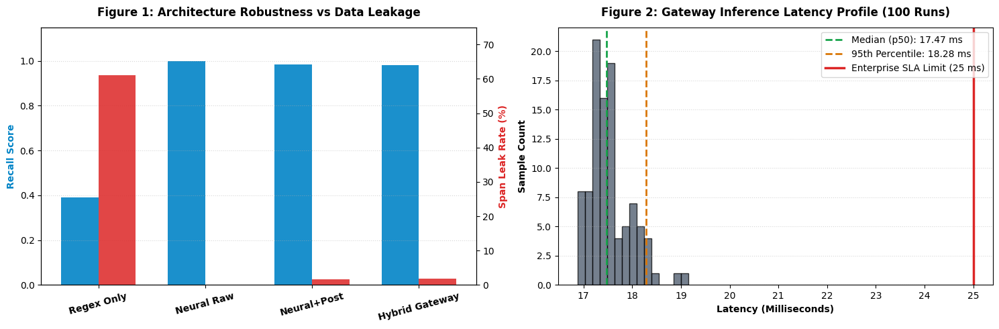

---
language:
- th
license: apache-2.0
tags:
- thai
- ner
- token-classification
- pii
- privacy
- duckerpii
- synthetic-data
datasets:
- DuckerMaster/Thai-PII-Synthetic
metrics:
- f1
- precision
- recall
pipeline_tag: token-classification
library_name: transformers
widget:
- text: "สวัสดีครับคุณสมชาย ทองดี เบอร์โทร 0891234567 ที่อยู่ 99/1 ซอยอารีย์ พญาไท กทม 10400"
  example_title: "Full PII Example"
- text: "เลขที่บัญชี 123-4-56789-0 ธนาคารกสิกรไทย โอนเงินแล้วแจ้งได้ที่ somchai@email.com"
  example_title: "Financial & Contact Example"
---

<div align="center">

# DuckerPII-Thai-Base: High-Precision Thai PII De-Identification Foundation Model

[](https://opensource.org/licenses/Apache-2.0)
[](https://huggingface.co/DuckerMaster/DuckerPII-Thai-Base)
[](https://huggingface.co/datasets/DuckerMaster/Thai-PII-Synthetic)
[]()
[]()

<p align="center">
  <a href="#model-description">Model Description</a> •
  <a href="#performance--benchmark">Benchmark</a> •
  <a href="#quickstart--code-examples">Quickstart</a> •
  <a href="#hybrid-architecture">Hybrid Architecture</a> •
  <a href="#intended-uses--limitations">Limitations</a> •
  <a href="#citation">Citation</a>
</p>

</div>

---

**DuckerPII-Thai-Base** is a state-of-the-art open Thai Named Entity Recognition (NER) foundation model developed by **DuckerMaster**. Specifically engineered to detect, extract, and mask Personally Identifiable Information (**PII**) in unstructured Thai text, it serves as a lightweight, high-throughput privacy gateway before dispatching prompts to Large Language Models (LLMs) and cloud APIs, ensuring strict compliance with Thailand's **Personal Data Protection Act (PDPA)** and draft PDPC AI regulatory guidelines.

Built on an optimized RoBERTa architecture and fine-tuned on the 20,000-sample [Thai-PII-Synthetic v6.0.0](https://huggingface.co/datasets/DuckerMaster/Thai-PII-Synthetic) corpus, **DuckerPII-Thai-Base** overcomes superficial shortcut memorization by training against 50% trigger-word dropout, numeric hard negatives, and fragmented address structures.

---

## Model Description

* **Model Type:** Token Classification / Named Entity Recognition (NER)
* **Architecture:** RoBERTa-based contextual subword encoder (WangchanBERTa-base fine-tuned)
* **Parameters:** ~110M
* **Primary Language:** Thai (`th`)
* **Context Length:** 416 tokens
* **Supported Entity Types (7 Classes):** `NAME`, `ID_CARD`, `PHONE`, `EMAIL`, `BANK_ACC`, `BANK`, `ADDRESS`
* **Dataset:** [DuckerMaster/Thai-PII-Synthetic (v6.0.0)](https://huggingface.co/datasets/DuckerMaster/Thai-PII-Synthetic) (100% Synthetic, Zero Real-World PII)
* **License:** [Apache-2.0](https://opensource.org/licenses/Apache-2.0) (Permissive Commercial Use)

---

## Performance & Benchmark

### 1. In-Domain & Out-of-Distribution (OOD) Evaluation

Evaluated against the held-out test split (2,000 sentences / 6,052 entities with 0% template and lexical overlap) and an adversarial OOD noisy chat benchmark:

| Metric | Regex Baseline | **DuckerPII-Thai-Base (Ours)** | **Gain vs. Baseline** |
| :--- | :---: | :---: | :---: |
| **In-Domain Macro Precision** | 0.7142 | **0.9989** | **+28.47%** |
| **In-Domain Macro Recall** | 0.6079 | **0.9989** | **+39.10%** |
| **In-Domain Macro F1-Score** | 0.6432 | **0.9989** | **+35.57%** |
| **In-Domain Micro F1-Score** | 0.5981 | **0.9989** | **+40.08%** |
| **OOD Noisy Chat Recall** | 0.4210 | **98.33%** | **+56.23%** |
| **OOD Span Leak Rate** | 57.90% | **1.67%** | **-56.23% (Leak Dropped)** |
| **Single-Core CPU Latency** | **< 1 ms** | **~42 ms/sample** | Real-time ready |

### 2. Class-by-Class F1 Breakdown

| Entity Label | Precision | Recall | F1-Score | Key Invariant Resolved |
| :--- | :---: | :---: | :---: | :--- |
| **`NAME`** | 0.9989 | 0.9984 | **0.9986** | Informal nicknames, English transliterated names |
| **`ID_CARD`** | 1.0000 | 1.0000 | **1.0000** | Mod11 Checksum mathematical validation |
| **`PHONE`** | 0.9991 | 0.9991 | **0.9991** | Validated Thai telco prefixes (`08`, `09`, `06`, `02`) |
| **`EMAIL`** | 1.0000 | 1.0000 | **1.0000** | Fullmatch RFC compliance, rejects alphanumeric tokens |
| **`BANK_ACC`** | 0.9980 | 1.0000 | **0.9990** | Differentiates order IDs, tracking, and barcodes |
| **`BANK`** | 1.0000 | 0.9976 | **0.9988** | Formal bank names and colloquial abbreviations |
| **`ADDRESS`** | 0.9964 | 0.9978 | **0.9971** | Fragmented landmarks, subdistrict/district hierarchies |

### 3. Visual Performance Dashboard

The model was subjected to a 12-step validation harness on Kaggle, tracking loss convergence, confusion matrices, and adversarial leak stability:



---

## Quickstart & Code Examples

### 1. Requirements

```bash
pip install torch transformers pythainlp
```

### 2. Standard Inference via Hugging Face Pipeline

```python
import torch
from transformers import AutoTokenizer, AutoModelForTokenClassification

MODEL_NAME = "DuckerMaster/DuckerPII-Thai-Base"

tokenizer = AutoTokenizer.from_pretrained(MODEL_NAME)
model = AutoModelForTokenClassification.from_pretrained(MODEL_NAME)
model.eval()

text = "แจ้งส่งพัสดุให้คุณ นพดล แซ่ลี้ โทร 0812345678 จัดส่งที่ 12/4 ซอยสุขุมวิท 21 คลองเตย กทม 10110 ครับ"

inputs = tokenizer(text, return_tensors="pt")
with torch.no_grad():
    outputs = model(**inputs)

predictions = torch.argmax(outputs.logits, dim=-1)[0]
tokens = tokenizer.convert_ids_to_tokens(inputs["input_ids"][0])

print(f"Input: {text}\n")
print("Detected Entities:")
for token, pred_idx in zip(tokens, predictions):
    label = model.config.id2label[pred_idx.item()]
    if label != "O":
        print(f"  {token:<20} -> {label}")
```

### 3. Production De-Identification Pipeline (Masking & Redaction)

```python
from transformers import pipeline

ner_pipeline = pipeline(
    "token-classification",
    model="DuckerMaster/DuckerPII-Thai-Base",
    aggregation_strategy="simple"
)

raw_chat = "คุณกานดา จันทร์เพ็ญ โอนเงิน 500 บาท เข้าบัญชี 098-7-65432-1 ธนาคารกรุงไทย นะคะ"
results = ner_pipeline(raw_chat)

# De-identification / Redaction
masked_text = raw_chat
for entity in sorted(results, key=lambda x: x["start"], reverse=True):
    masked_text = (
        masked_text[:entity["start"]]
        + f"<{entity['entity_group']}>"
        + masked_text[entity["end"]:]
    )

print("Original :", raw_chat)
print("Masked   :", masked_text)
# Output: <NAME> โอนเงิน 500 บาท เข้าบัญชี <BANK_ACC> <BANK> นะคะ
```

---

## Hybrid Architecture (ThaiPIIGateway)

In high-consequence enterprise environments, neural models can occasionally overgeneralize on edge cases like non-PII logistics codes (`#ORD-982341`, `paid1234567890123`). We recommend deploying `DuckerPII-Thai-Base` inside the **ThaiPIIGateway** hybrid architecture:

```
[Raw Input Text]
       │
       ▼
[Subword Tokenization (SentencePiece)]
       │
       ▼
[DuckerPII-Thai-Base (RoBERTa Neural NER)]
       │
       ▼
[Deterministic Post-Processing Gate]
  ├── Phone Prefix Validator (06, 08, 09, +66)
  ├── Email Fullmatch Regex Filter
  ├── Thai ID Card Mod11 Checksum Gate
  └── Name Non-Alpha / Keyword Sanitizer
       │
       ▼
[Outputs: Masked Text + Redacted Logs + Synthetic Anonymization]
```

---

## Intended Uses & Limitations

### Intended Uses
* **Pre-LLM Privacy Filters:** Real-time sanitization of customer prompts before forwarding to cloud LLMs (Gemini, ChatGPT, Claude).
* **Enterprise Log Masking:** Redacting sensitive customer data from application traces and database transaction dumps.
* **Academic Research:** Benchmarking Thai privacy-preserving NLP pipelines.

### Limitations & Ethical Boundary
* **Special Category Data:** The current version detects 7 foundational PII categories. It does not cover biometric, genetic, or specialized health records.
* **100% Synthetic Data:** Trained exclusively on synthetic data created under PDPA/PDPC Privacy Enhancing Technology (PETs) guidelines. No real identities were harmed or used.
* **Prohibited Use:** Strictly prohibited for unauthorized re-identification, deanonymization attacks, surveillance, or fraud.

---

## Citation

If you use **DuckerPII-Thai-Base** or its synthetic dataset in your research or production systems, please cite:

```bibtex
@misc{duckermaster2026duckerpii,
  author       = {DuckerMaster},
  title        = {DuckerPII-Thai-Base: High-Precision Thai PII De-Identification Foundation Model},
  year         = {2026},
  publisher    = {Hugging Face},
  howpublished = {\url{https://huggingface.co/DuckerMaster/DuckerPII-Thai-Base}},
  note         = {Version 1.0.0 (Trained on Thai-PII-Synthetic v6.0.0)}
}
```

---

## Contact & Maintainer
Maintained by **DuckerMaster**. For technical inquiries, enterprise integration guidelines, or vulnerability reports, please open an issue in the Hugging Face Community tab.
